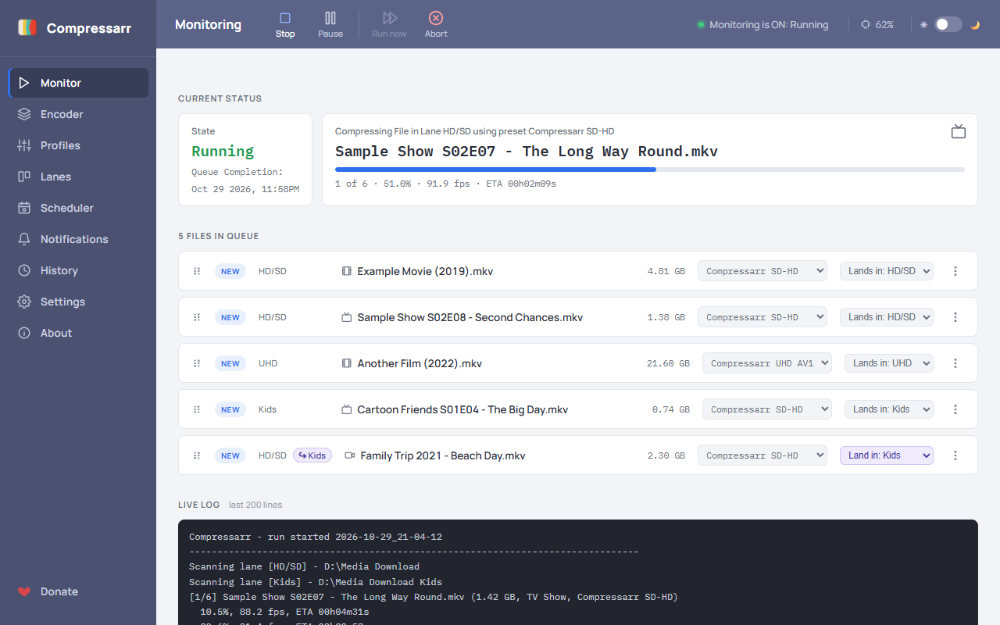
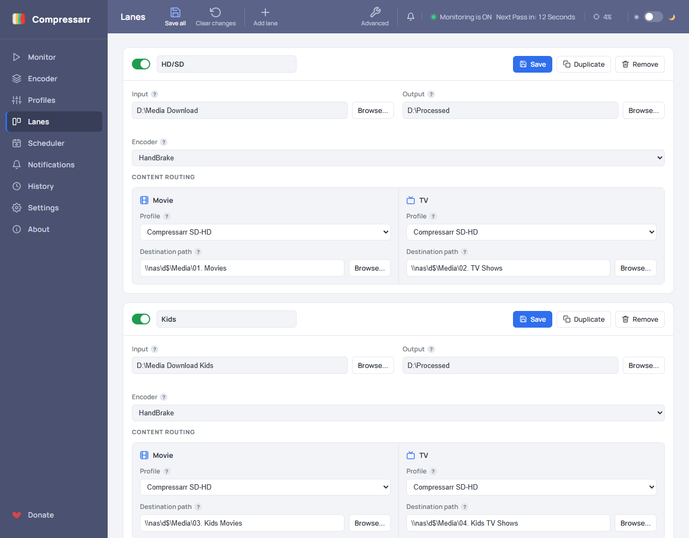
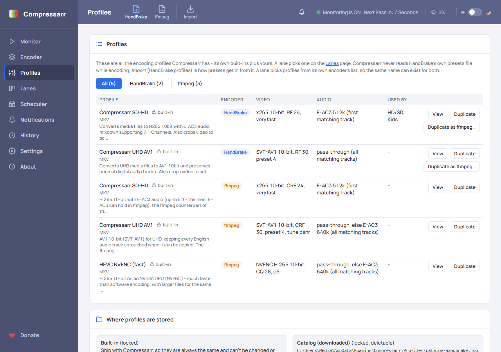
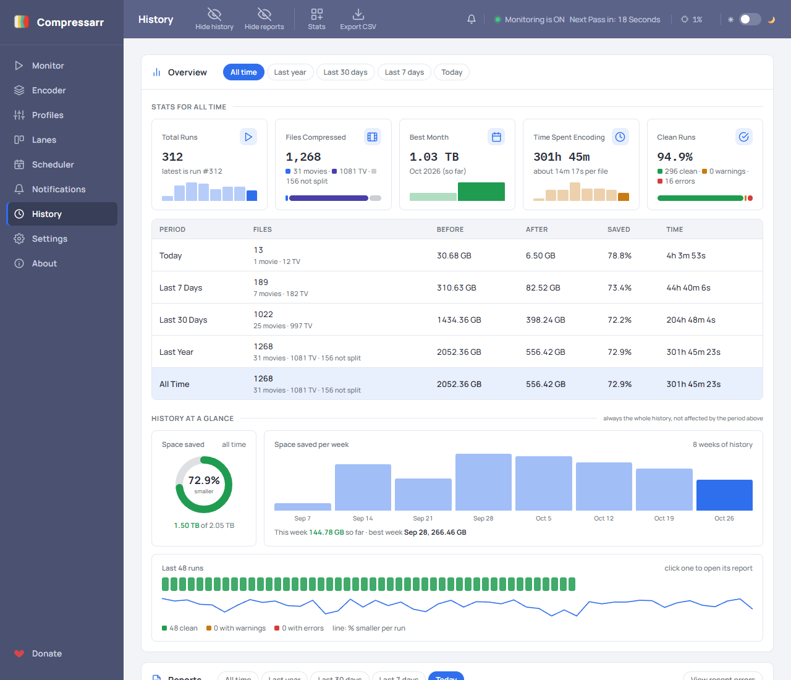
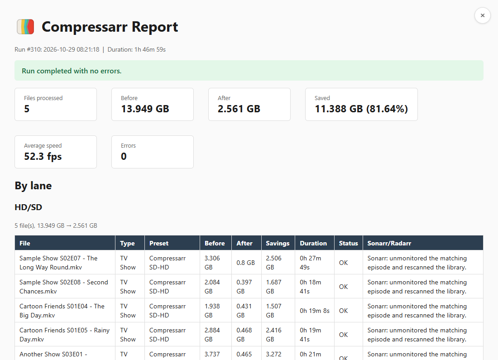
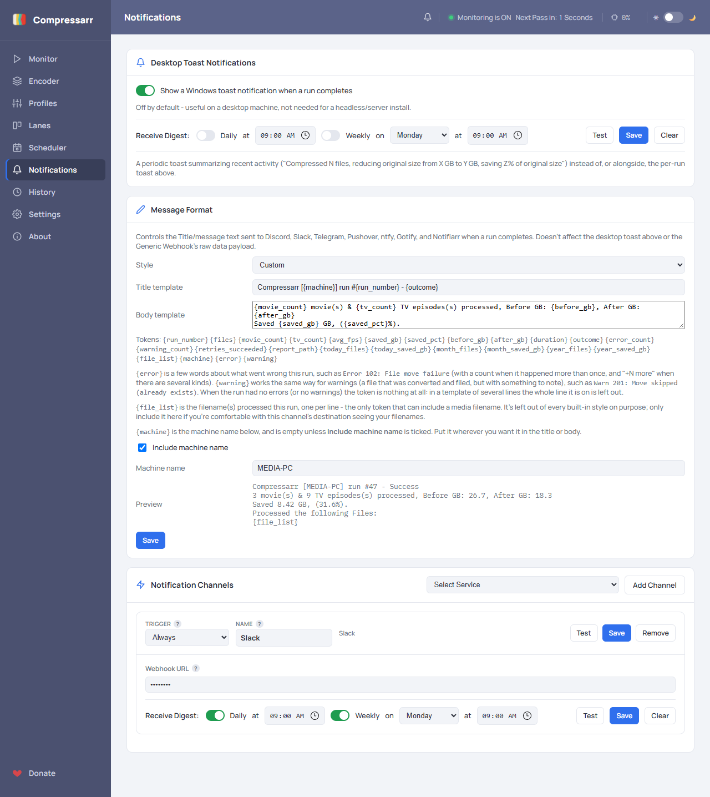

# Compressarr<br>

<sub><i>Because size matters.</i></sub>

**[compressarr.tv](https://compressarr.tv)** · **[Wiki (full guide)](https://github.com/Compressarr/Compressarr/wiki)** · **[Releases](https://github.com/Compressarr/Compressarr/releases)** · **[Changelog](CHANGELOG.md)**

<br clear="left">

Compressarr watches your folders, shrinks new video with **HandBrake** (or **ffmpeg**), files the result into an organised TV Show / Movie library, cleans up after itself, tells Sonarr and
Radarr the item no longer needs monitoring, and sends you a report and a notification - with nothing manual in between. It runs as a tray icon on Windows and everything else happens in your
browser, from your PC or from your phone.

It is made to sit between Sonarr / Radarr and your media server (Plex, Jellyfin, Emby). Point your *arr app at one of Compressarr's watched folders instead of at your library: once it
grabs a file and drops it there, Compressarr compresses it and moves the finished result into your library, so only clean, already-processed files ever reach your media server, using a
fraction of the space.



*The media shown is test data only. Your own results (speed, file size, savings) depend on your source files, hardware and profile.*

## What's new in 3.0

Compressarr 3.0 is the work that was first called 2.2, grown into a new generation. Compared with 2.1.10 (the last 2.x release) it adds:

- **A second encoder: ffmpeg**, chosen per lane, with a profile editor, a preview of what a profile will do to a real file, hardware encoders (NVENC) and AV1. HandBrake stays the default.
- **Your own profiles and a preset catalog.** Create, edit, duplicate and import encoding profiles, or install extra ones from the official catalog without waiting for a new release.
- **Passthrough**: all of Compressarr's filing, renaming and cleanup without re-encoding the video.
- **A day/night Scheduler** and **lane assignment** (finish a file normally but file it in another lane's library).
- **A run history and queue that live in databases**: fast and crash-safe, with reports built when you open them, and a redesigned **History page** with stat cards, a period selector and charts.
- **A web sign-in and an Automation API** for Home Assistant and scripts: two API keys, status, queue, statistics and reports, and a call that **holds the queue** while the TV is on.
- **Posters** on the queue (TMDb or OMDb), **Plex editions**, and a **TV / movie / video icon** on every queued file.
- **Everything is signed**, so Windows 11 Smart App Control no longer blocks Compressarr itself.

The full list is in the [changelog](CHANGELOG.md). Upgrading from 2.1? See [Upgrading](#upgrading-from-2x).

## How it works

```
Watch folder → Detect TV / Movie → Compress → File into library
   → Clean up source → Unmonitor in Sonarr / Radarr → Report + notification
```

1. **Watch** - each lane's Input folder is scanned for new video files, continuously while monitoring is on or once on demand (Run Now).
2. **Detect** - every file is classified from its name as a TV episode (a season and episode marker such as `S01E01`) or a movie, so one lane handles both.
3. **Compress** - HandBrakeCLI or ffmpeg encodes it with the profile chosen for that lane and type, with live progress on the Monitor page.
4. **File it** - the result and its companion files (subtitles, `.nfo`, artwork) go into `Show Name\Season NN\` or `Movie Title (Year)\` in your library.
5. **Clean up** - the original is deleted, recycled or kept as you choose, and emptied source folders are removed.
6. **Notify Sonarr / Radarr** *(optional)* - the episode or movie is marked unmonitored so it is not grabbed again.
7. **Report** - a report is built from the run's record, and Discord, Slack, Telegram, Pushover, ntfy, Gotify, Notifiarr, IFTTT, a webhook or a Windows toast tells you it is done.

> [!NOTE]
> Compressarr contains no AI or machine learning at runtime. Movie/TV detection, file matching and renaming all run on plain, inspectable pattern matching - the same deterministic logic every
> time, nothing generative involved.

## Features

### Lanes: as many as you need

A **lane** is one Input folder to watch, where finished files go, and the profiles to use. Add, duplicate, rename, enable and disable lanes freely; give one lane ffmpeg and another HandBrake,
or send a stray file to a different lane's library from the queue. Libraries are never created for you, so a missing drive is reported, not quietly replaced by an empty folder.



### Two encoders, and profiles you control

Compressarr ships with **Compressarr SD-HD** (H.265, for standard and HD sources) and **Compressarr UHD AV1** (for 4K) for both encoders, plus an ffmpeg-only NVENC profile for NVIDIA GPUs. In
testing the first two reached **70-80% or more** size reductions, depending heavily on the source. The Profiles page lists every profile, locks the built-ins and lets you edit your own, import HandBrake presets, or turn a HandBrake
profile into the closest ffmpeg one. Dolby Vision and HDR10+ files are never silently flattened. See [Encoders and Profiles](https://github.com/Compressarr/Compressarr/wiki/Encoders-and-Profiles).



### A queue you can see and change

The Monitor lists every file waiting across all lanes in the order they will run, with a TV, film strip or camera icon, its size and its profile. Drag to reorder, skip, remove, give one file a
different profile, or choose which lane's library it lands in. A file's place in line is locked when Compressarr first sees it, so nothing reshuffles it behind your back. Start and stop monitoring,
pause, run now, abort, or let the **Scheduler** run encodes at a lower priority by day or only at night.

### History and reports

Every run is kept in a database: each file's size before and after, time, speed, lane, tool and profile. The History page shows your totals for any period, with stat cards you can choose and
rearrange, charts and a ribbon of recent runs, and opens any run as a report with the same detail.





### Notifications

Add as many channels as you like, each with its own trigger (always, only on error or warning, never), message style and a Test button, plus optional daily and weekly digests.



### Automation, Home Assistant and security

Two API keys (one read-only) give scripts and dashboards the status, queue, lanes, schedule, runs, statistics and reports, and a control key can run a pass, pause, change the schedule or **hold the
queue**. There is a ready-made [Home Assistant card](https://github.com/Compressarr/Compressarr/wiki/Home-Assistant-Integration). On your own network nothing asks for a password; from outside it,
the web interface needs the sign-in you set up in Settings > Security, and saved keys are never sent back to the browser. See [API and Automation](https://github.com/Compressarr/Compressarr/wiki/API-and-Automation).

### And more

Optional **FileBot** renaming before a scan; **Plex edition** tags (`{edition-Name}`) filed the way Plex expects; **queue posters** from TMDb or OMDb; scheduled and downloadable **backups** that
carry your settings, profiles, queue and history; a start-up window; and an installer where every program file is signed.

## Installation

Compressarr needs **Windows 10 (version 2004) or later, 64-bit**.

1. Pick an installer from the [Releases](https://github.com/Compressarr/Compressarr/releases) page. Both behave identically; the only difference is whether the .NET runtime comes bundled:
   - **`Compressarr-Setup-x.x.x.exe`** (smaller) needs the **.NET 10 ASP.NET Core Runtime (x64)** installed first, which is one download:
     [aspnetcore-runtime-10.0.11-win-x64.exe](https://builds.dotnet.microsoft.com/dotnet/aspnetcore/Runtime/10.0.11/aspnetcore-runtime-10.0.11-win-x64.exe). Any 10.0.x patch works. If you use the
     [general runtime page](https://dotnet.microsoft.com/en-us/download/dotnet/10.0/runtime) instead, pick **ASP.NET Core Runtime**, not the Desktop Runtime or the plain .NET Runtime:
     Compressarr hosts its own web interface, and without the ASP.NET Core one it refuses to start with a "You must install or update .NET" message.
   - **`Compressarr-Setup-x.x.x-Full.exe`** (larger) includes the runtime, so there is nothing to install first.
2. Run it and follow the installer. It installs to Program Files, adds a Start Menu shortcut (and an optional desktop icon) and registers a normal Windows uninstaller.

   > **SmartScreen.** Compressarr is signed with a real publisher certificate, but Windows also weighs how many machines have run the exact file, so a freshly published release can show a
   > "Windows protected your PC" prompt for the first few days. Click **More info**, then **Run anyway**. Every release is scanned with [VirusTotal](https://www.virustotal.com/); the link is at
   > the bottom of each release's notes.
   >
   > **Smart App Control (Windows 11)** may show a one-time notice about HandBrakeCLI or ffmpeg the first time Compressarr starts after an installation: those programs are third-party and
   > unsigned. See [Troubleshooting](https://github.com/Compressarr/Compressarr/wiki/Troubleshooting).
3. Start Compressarr from the Start Menu. It runs as a **tray icon with no window of its own**: right-click it and choose **Open Web UI**, or browse to `http://localhost:1212`.
4. On the **Encoder** page use **Check/Install** next to HandBrakeCLI to find an existing copy or download one. The built-in profiles need nothing else; the Monitor shows a *Finish setting up*
   notice until the tools your lanes need are found.

## Quick start

1. On the **Lanes** page add a lane: the **Input** folder to watch, an **Output** folder for in-progress files, and your TV and Movie library folders.
2. On the **Monitor** page click **Start**.
3. Drop a video into the Input folder. Compressarr finds it, compresses it, files it into your library and tells you when it is done.

The wiki's [First-Time Setup](https://github.com/Compressarr/Compressarr/wiki/First-Time-Setup) walks through it with pictures.

## Documentation

Everything else is in the **[wiki](https://github.com/Compressarr/Compressarr/wiki)**:

| | |
|---|---|
| **Getting started** | [Installation](https://github.com/Compressarr/Compressarr/wiki/Installation) · [First-Time Setup](https://github.com/Compressarr/Compressarr/wiki/First-Time-Setup) · [Understanding Lanes](https://github.com/Compressarr/Compressarr/wiki/Understanding-Lanes) · [Understanding Presets](https://github.com/Compressarr/Compressarr/wiki/Understanding-Presets) · [The Monitor Page](https://github.com/Compressarr/Compressarr/wiki/The-Monitor-Page) |
| **Using it** | [The Scheduler](https://github.com/Compressarr/Compressarr/wiki/The-Scheduler-Page) · [Encoders and Profiles](https://github.com/Compressarr/Compressarr/wiki/Encoders-and-Profiles) · [The Preset Catalog](https://github.com/Compressarr/Compressarr/wiki/The-Preset-Catalog) · [History](https://github.com/Compressarr/Compressarr/wiki/History-Page) · [Notifications](https://github.com/Compressarr/Compressarr/wiki/Notifications) · [Backups & Restore](https://github.com/Compressarr/Compressarr/wiki/Backups-and-Restore) |
| **Reference** | [Settings](https://github.com/Compressarr/Compressarr/wiki/Settings-Reference) · [Configuration file](https://github.com/Compressarr/Compressarr/wiki/Configuration-File-Reference) · [API and Automation](https://github.com/Compressarr/Compressarr/wiki/API-and-Automation) · [Home Assistant](https://github.com/Compressarr/Compressarr/wiki/Home-Assistant-Integration) |
| **Help** | [Troubleshooting](https://github.com/Compressarr/Compressarr/wiki/Troubleshooting) · [Updating Compressarr](https://github.com/Compressarr/Compressarr/wiki/Updating-Compressarr) |

Found a bug or have an idea? Open an [issue](https://github.com/Compressarr/Compressarr/issues).

## Upgrading from 2.x

Install 3.0 over your 2.1 install. Your settings, lanes and queue carry over, and **the first start moves your run history into a database by itself** (the old file is kept as
`Compressarr_History.csv.imported`). Going back to 2.1 afterwards is not supported, because 2.1 cannot read the new databases, so take a backup (Settings > Backup & Restore) first if you want a way
back. One behaviour changes: **anyone outside your own network now needs a login**; on your own network and on the computer Compressarr runs on nothing changes. See the
[changelog](CHANGELOG.md) for details. 2.1.10 is the last 2.x release.

## Project layout

```
src/
  Compressarr.Core/       Conversion engine, config, history, reporting, HandBrake / ffmpeg / Sonarr / Radarr clients - no UI dependencies
  Compressarr.Web/        Minimal-API endpoints and wwwroot (the whole browser UI: vanilla JS, HTML and CSS)
  Compressarr.Desktop/    Tray-only host: Avalonia tray icon, Windows toast notifications, composition root
installer/
  Compressarr.iss         Inno Setup script; builds both installers (regular and bundled "Full") from one script
tests/
  Compressarr.Core.Tests/ xUnit tests for Core
  Compressarr.Web.Tests/  xUnit tests for the web layer
docs/                     Design notes and the manual test plan
CHANGELOG.md              Release history
```

## Lineage

Compressarr is a complete rewrite of an original PowerShell tool as a web-first app. Both trace back to [VidMonHB](https://github.com/mrpaulwasserman/VidMonHB), Paul Wasserman's original take on
the same idea.

## TagLib-Sharp (metadata handling)

Compressarr uses [TagLib-Sharp](https://github.com/mono/taglib-sharp), an open-source, cross-platform .NET library for reading and writing media file tags, to strip the embedded title tag from
converted files, so a media server reads the filename instead of a stale or incorrect title baked into the file. It is controlled by the **Clear title metadata** setting (on by default).

## Disclaimer

Compressarr is intended for personal use only, with media files you legally own or otherwise have the right to compress and manage. You are solely responsible for ensuring your use complies with
applicable copyright law and any licensing terms attached to your media. This tool is provided as-is, with no warranty of any kind - use it at your own risk.

## License

Compressarr is licensed under the [GNU General Public License v3.0](LICENSE).

Copyright (C) 2026 Mark Wasserman

The components Compressarr is built with, and their licenses, are listed in [THIRD-PARTY-NOTICES.txt](THIRD-PARTY-NOTICES.txt); both files are installed with the program and linked from its About
page. HandBrake and ffmpeg are not part of Compressarr - if you download them from inside it, they stay under their own licenses.
